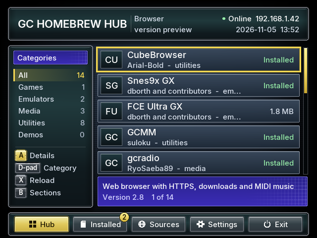
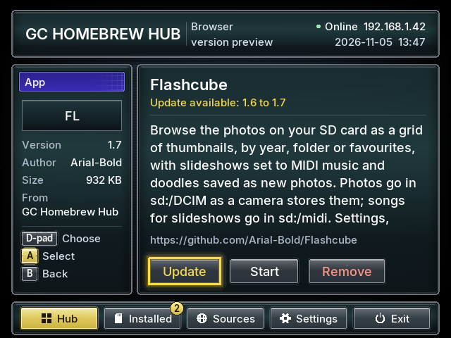
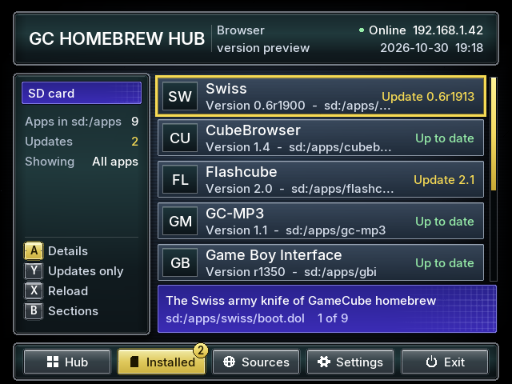
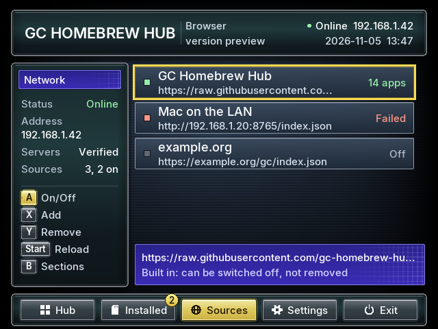

# GC Homebrew Hub Browser

A homebrew app store for the Nintendo GameCube, in the spirit of the Wii's
Homebrew Browser. Browse catalogs of GameCube homebrew, install, update,
remove and start apps on the SD card, without taking the card out of the
console. It follows the look of the Swiss "System" theme
([Arial-Bold/swiss-gc-system-UI](https://github.com/Arial-Bold/swiss-gc-system-UI)):
a dark TV-screen backdrop, teal-black framed panels, frosted list rows, grey
glass buttons with a gold selection ring, and large, sharp text in
[Inter](https://rsms.me/inter/) baked at the exact sizes it is drawn.

Written from scratch in C on [libogc2](https://github.com/extremscorner/libogc2).
Not related to any web browser.

## What you need

- A GameCube with a network adapter (the official Broadband Adapter or a
  WIZnet-based one such as ETH2GC) on a network with DHCP.
- An SD card in an SD2SP2 (serial port 2) or an SD adapter in memory card
  slot A or B, formatted FAT32.
- A way to start homebrew (Swiss, a GCLoader, a modchip, ...).

## Putting it on the card

Build (or download) and copy the `package/apps` folder to the root of the
card, so the card has:

```
sd:/apps/gc-homebrew-hub-browser/boot.dol
sd:/apps/gc-homebrew-hub-browser/cacert.pem
```

`cacert.pem` is the set of trusted certificate authorities (the same bundle
curl ships). Without it HTTPS still works, but servers are not verified; the
Settings screen says which it is.

The program keeps its files next to `boot.dol`: `settings.ini`, `sources.txt`,
`installed.txt` and `cache/` (the last copy of every catalog, so the lists
work offline).

## Using it

Every screen has the same frame: a title bar along the top, the bar of
sections along the bottom, a side pane on the left (context and the buttons
that work here) and a list on the right, with the selected row's description
in the indigo bar under it.

| Section | |
|---|---|
| **Hub** | the apps the sources list. Left/Right pick a category, A opens the details page (Install, Update, Start, Remove). |
| **Installed** | everything in `sd:/apps`. A opens an app. Y shows only apps with an update; there, A asks to install it. The gold count on the button is the number of updates. |
| **Sources** | the catalogs apps come from. A switches one on or off, X adds one (on-screen keyboard), Y removes one you added, Start reloads them. |
| **Settings** | load the catalogs at start, certificate checking, what leaving does, and a Leave entry. |
| **Exit** | reboots the GameCube or returns to the loader (Settings picks which), after asking. |

The program opens on the Hub. B moves down into the bar of sections (B again
or Up moves back), Left/Right pick a section and A opens it; on a details page
B goes back to the list. L/R page through long lists, X reloads the catalogs.

| | |
|---|---|
|  |  |
|  |  |

These are renders from `make preview` (below), with the same font textures the
console draws.

Apps install to `sd:/apps/<folder>/`, the layout Swiss uses, so they also show
up in Swiss. An app's own data folders at the root of the card (for example
`sd:/flashcube`) are copied on the first install and left alone afterwards,
also when the app is removed.

Starting an app from here hands the console over to it, with its own path as
`argv[0]`. Programs that load into the top of memory or below 0x80003100
cannot be started this way; start those from Swiss.

## Where the apps come from

The default source list is fetched from the
[gc-homebrew-hub-catalog](https://github.com/gc-homebrew-hub/gc-homebrew-hub-catalog) repository
(`sources.json`), and every source is an `index.json` in catalog format 1.
That repository's README explains how to add an app with a pull request. Any web server can host a source; add its `index.json` address under
Sources.

## Building

Everything needed is in the libogc2 Docker image, except mbedTLS, which
`get-deps.sh` downloads:

```bash
./get-deps.sh
docker run --rm -v "$PWD:/src" -w /src ghcr.io/extremscorner/libogc2:latest make
```

`make package` then assembles `package/apps/gc-homebrew-hub-browser/` for the
card. The build must stay warning-free.

GitHub Actions (`.github/workflows/build.yml`) does the same on every push,
fails on warnings in `source/`, runs `make test`, and attaches the `package`
folder to the run: open the run under Actions (or the pull request's Checks)
and download the artifact.

On `main` (and when started by hand) a second job runs the new `boot.dol` in
Dolphin on a virtual display (`tools/dolphin/run.sh`), fails if Dolphin
reports a crash, and keeps a few frames: in the run's
`dolphin-screenshots-<commit>` artifact and on the `dolphin-screenshots`
branch, which always holds the latest `main` run. Starting the Build workflow
by hand also takes crash addresses (Dolphin's `PC = ...`) or function names
and prints where they are in `boot.elf`; each run keeps `boot.elf` and its
map in a `-symbols-` artifact.

### In Dolphin

Open `boot.dol` with Dolphin. For the network, set Config → GameCube → SP1
to "Broadband Adapter (HLE)", then in that adapter's settings change the DNS
server from 3.18.217.27 to a public one such as 1.1.1.1 (in `Dolphin.ini`:
`BBA_BUILTIN_DNS = 1.1.1.1` under `[Core]`). The default sends every name to a
game-revival server, so every catalog fails with "TLS handshake failed
(-0x6E80)". The first connection takes a minute or two: getting an address,
then the TLS handshake on the emulated CPU. Dolphin has no GameCube SD adapter, so the
program runs without a card: the catalogs load and can be browsed, but
nothing can be installed and Installed stays empty.

### Releases

Pushing a version tag publishes a GitHub Release with
`gc-homebrew-hub-browser-<tag>.zip` (the `apps` folder for the card):

1. Set `VERSION` in the `Makefile` (it is also the version shown under
   Settings) and merge that to `main`.
2. `git tag v0.2 && git push origin v0.2` on that commit (or create the tag
   from GitHub's "Draft a new release" page).

The workflow refuses a tag that does not match `VERSION`, so `v0.2` needs
`VERSION := 0.2`. Release notes are generated from the merged pull requests.

`make test` builds and runs the host-side tests (JSON, SHA-256, catalog and
file helpers) with the normal C compiler; no devkitPPC needed.

`make preview` renders the screens to `tools/preview/out/*.png`, also on the
host: the real menu and screen code runs against a small software version of
GX (`tools/preview/gx_soft.c`), a made-up card and catalog, and a script of
button presses. It needs Python 3 with Pillow (to write the PNG files). The
text comes from the program's own font textures, read in their GX format, so
it looks as it does on the console. It has no depth buffer, culling or anti-aliasing, which
the program does not use either, but it is not the console: check new
drawing code on hardware.

### The font

The text is [Inter](https://rsms.me/inter/) (SIL Open Font License 1.1,
`tools/font/OFL.txt`), baked by `tools/font/bake_font.py` into
`source/font_data.c`: printable ASCII at 13, 15, 18 and 22 pixels, each size a
GX texture in IA4 format (about 79 KB in all). Each glyph is drawn 1:1 at a
whole-pixel position with no filtering, so nothing is scaled or blurred. The
generated file is committed; after changing the sizes in the script, run
`make font` (needs Python 3 with Pillow). `make package` puts the licence on
the card as `licenses/inter-ofl.txt`.

## Layout

| Module | Role |
|---|---|
| `video.c`, `font.c`, `font_data.c` | GX setup, 2D primitives, text (Inter, baked by `tools/font/bake_font.py`) |
| `menu.c`, `screens.c`, `ui.c`, `osk.c` | the frame (title bar, bar of sections), the sections, the look (backdrop, panels, rows, buttons, gold ring, description bar, icons), keyboard |
| `catalog.c`, `json.c` | sources, catalog parsing, the installed list, versions |
| `store.c` | the worker thread: network start, catalog refresh, install, remove |
| `net.c` | DHCP, DNS, SNTP, HTTP/HTTPS client (mbedTLS) |
| `zipx.c`, `digest.c`, `fsutil.c` | unzip (libzip), SHA-256, file helpers |
| `dol.c`, `dol_stub.S` | starting another program |

## Known limits

- No entropy source exists on the GameCube; TLS randomness is derived from
  the time base. Treat downloads as "integrity-checked when the catalog gives
  a SHA-256", not as secret.
- DNS is resolved by asking the DHCP gateway, then public resolvers; the
  catalog format carries no icons yet.
- Tested on the host harness and the toolchain; hardware testing is what
  comes next.

## Licence

GC Homebrew Hub Browser is under the [MIT License](LICENSE). The libraries
built into `boot.dol`, the Inter font and the CA bundle keep their own
licences, listed in [licenses/README.txt](licenses/README.txt);
`make package` puts the MIT License (`license.txt`) and that folder next to
`boot.dol`.
