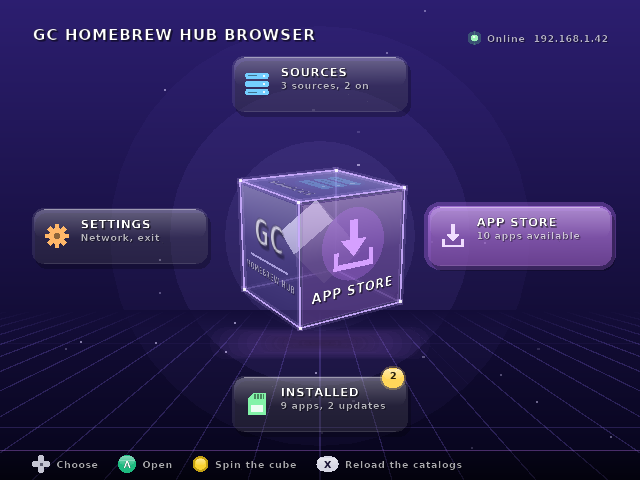
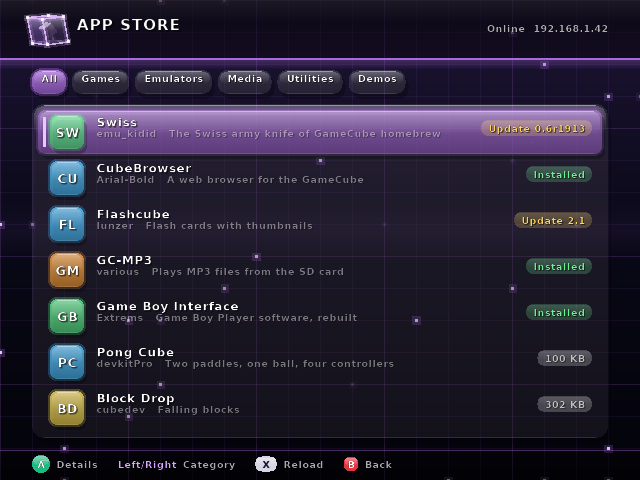

# GC Homebrew Hub Browser

A homebrew app store for the Nintendo GameCube, in the spirit of the Wii's
Homebrew Browser. Browse catalogs of GameCube homebrew, install, update,
remove and start apps on the SD card, without taking the card out of the
console. It looks like the console's own menu: a see-through glass cube with
a section on each side, dark glowing grids behind the sections, neon accents,
and the console's own boot-menu font.

Written from scratch in C on [libogc2](https://github.com/extremscorner/libogc2).
Not related to any web browser.

## What you need

- A GameCube with a network adapter (the official Broadband Adapter or a
  WIZnet-based one such as ETH2GC) on a network with DHCP.
- An SD card in an SD2SP2 (serial port 2) or an SD adapter in memory card
  slot A or B, formatted FAT32.
- A way to start homebrew (Swiss, a GCLoader, a modchip, ...).

## Putting it on the card

Build (or download) and copy the `package/apps` folder to the root of the
card, so the card has:

```
sd:/apps/gc-homebrew-hub-browser/boot.dol
sd:/apps/gc-homebrew-hub-browser/cacert.pem
```

`cacert.pem` is the set of trusted certificate authorities (the same bundle
curl ships). Without it HTTPS still works, but servers are not verified; the
Settings screen says which it is.

The program keeps its files next to `boot.dol`: `settings.ini`, `sources.txt`,
`installed.txt` and `cache/` (the last copy of every catalog, so the lists
work offline).

## Using it

| Direction | Section |
|---|---|
| Up | **Sources** (blue): the catalogs apps come from. A switches one on or off, X adds one (on-screen keyboard), Y removes one you added, Start reloads them. |
| Down | **Installed** (green): everything in `sd:/apps`, as a grid of blocks like the memory card screen. A opens an app (start, update, reinstall, remove). Y shows only apps with an update; there, A asks to install it. |
| Right | **App store** (violet): the apps the sources list. Left/Right pick a category, A opens the details page with Install. |
| Left | **Settings** (orange): load the catalogs at start, certificate checking, what leaving does, and a Leave entry. |

Press a direction twice (or a direction then A) to open a section; the cube
turns that face toward you and flies into it. B goes back to the cube. The
Control Stick leans the cube while you hold it, and the C-stick spins it
freely (it springs back when you let go). X on the cube reloads the catalogs.

| | |
|---|---|
|  |  |
|  |  |

These are renders from `make preview` (below), with a stand-in font; on the
console the text is the IPL font.

Apps install to `sd:/apps/<folder>/`, the layout Swiss uses, so they also show
up in Swiss. An app's own data folders at the root of the card (for example
`sd:/flashcube`) are copied on the first install and left alone afterwards,
also when the app is removed.

Starting an app from here hands the console over to it, with its own path as
`argv[0]`. Programs that load into the top of memory or below 0x80003100
cannot be started this way; start those from Swiss.

## Where the apps come from

The default source list is fetched from the
[gc-homebrew-hub](https://github.com/michaellunzer/gc-homebrew-hub) repository
(`sources.json`; that repository is still local only, so the default fails until it is published), and every source is an `index.json` in catalog format 1.
That repository's README explains how to add an app or a source with a pull
request. Any web server can host a source; add its `index.json` address under
Sources.

## Building

Everything needed is in the libogc2 Docker image, except mbedTLS, which
`get-deps.sh` downloads:

```bash
./get-deps.sh
docker run --rm -v "$PWD:/src" -w /src ghcr.io/extremscorner/libogc2:latest make
```

`make package` then assembles `package/apps/gc-homebrew-hub-browser/` for the
card. The build must stay warning-free.

`make test` builds and runs the host-side tests (JSON, SHA-256, catalog and
file helpers) with the normal C compiler; no devkitPPC needed.

`make preview` renders the screens to `tools/preview/out/*.png`, also on the
host: the real menu and screen code runs against a small software version of
GX (`tools/preview/gx_soft.c`), a made-up card and catalog, and a script of
button presses. It needs Python 3 with Pillow and a TrueType font standing in
for the console's ROM font (`FONT=/path/to/font.ttf`; DejaVu Sans Bold is
used when installed). It has no depth buffer, culling or anti-aliasing, which
the program does not use either, but it is not the console: check new
drawing code on hardware.

## Layout

| Module | Role |
|---|---|
| `video.c`, `font.c` | GX setup, 2D primitives, the glass cube (with drawing on its faces), text with the IPL font |
| `menu.c`, `screens.c`, `ui.c`, `osk.c` | the cube menu, the four sections, the look (palette, grid backgrounds, glass panels, button glyphs, icons), keyboard |
| `catalog.c`, `json.c` | sources, catalog parsing, the installed list, versions |
| `store.c` | the worker thread: network start, catalog refresh, install, remove |
| `net.c` | DHCP, DNS, SNTP, HTTP/HTTPS client (mbedTLS) |
| `zipx.c`, `digest.c`, `fsutil.c` | unzip (libzip), SHA-256, file helpers |
| `dol.c`, `dol_stub.S` | starting another program |

## Known limits

- No entropy source exists on the GameCube; TLS randomness is derived from
  the time base. Treat downloads as "integrity-checked when the catalog gives
  a SHA-256", not as secret.
- DNS is resolved by asking the DHCP gateway, then public resolvers; the
  catalog format carries no icons yet.
- Tested on the host harness and the toolchain; hardware testing is what
  comes next.
